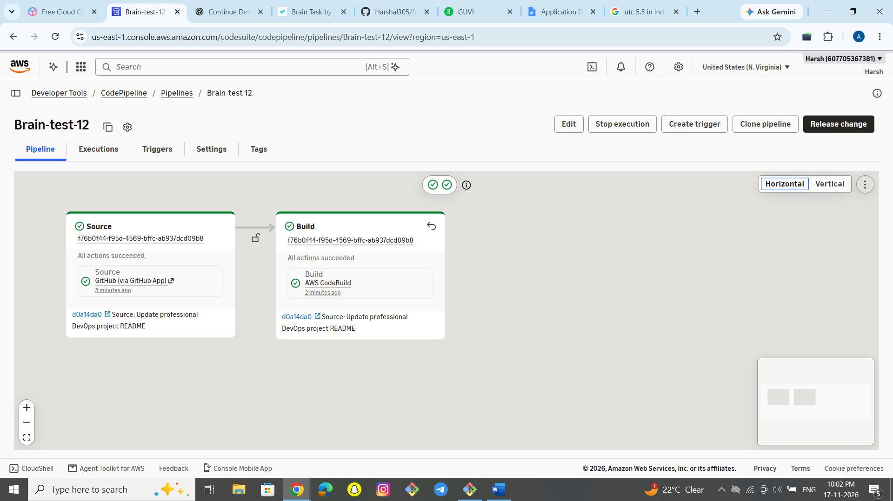
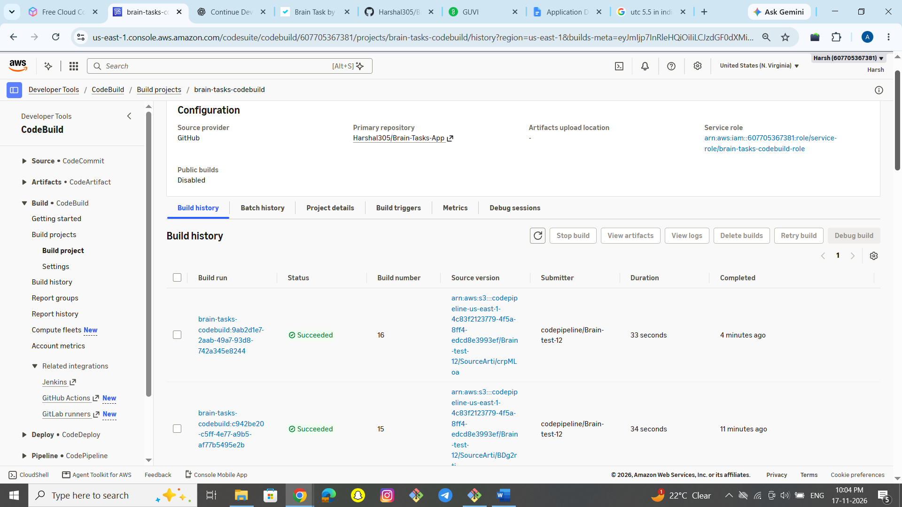
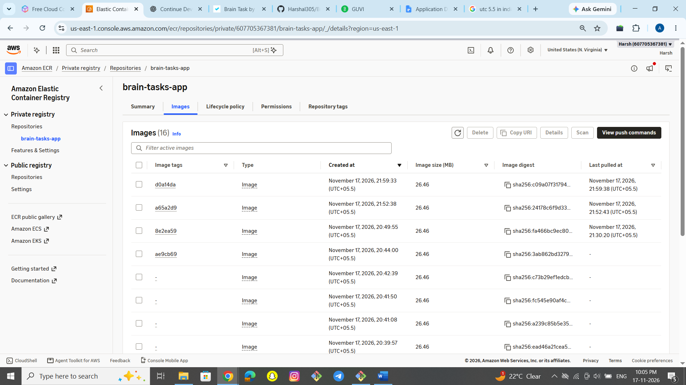
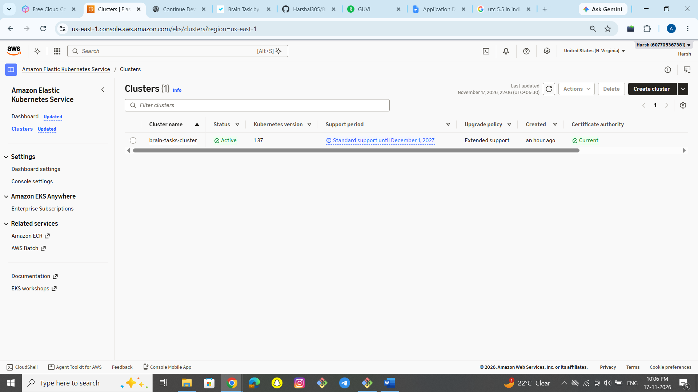
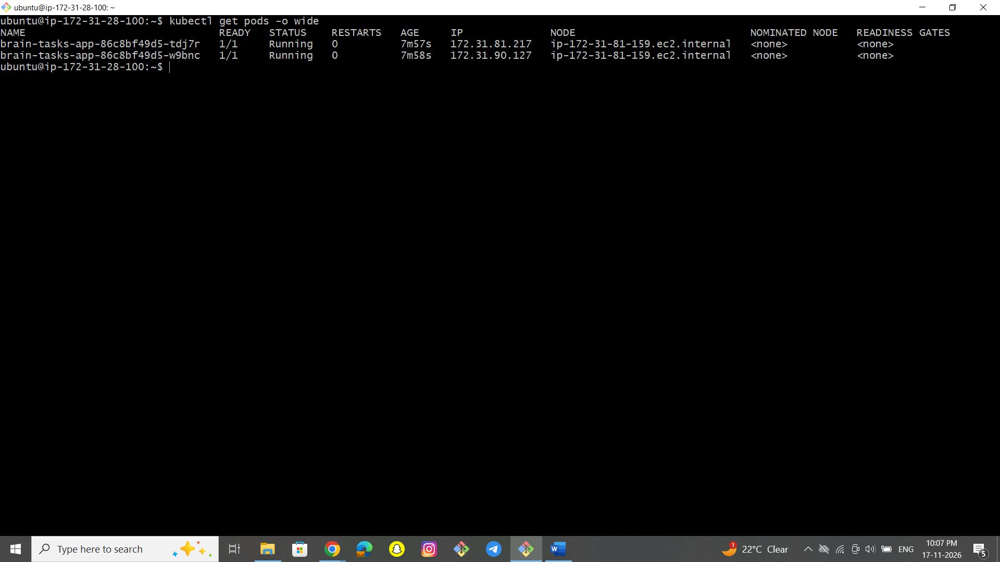
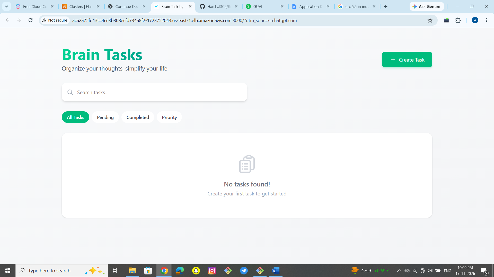
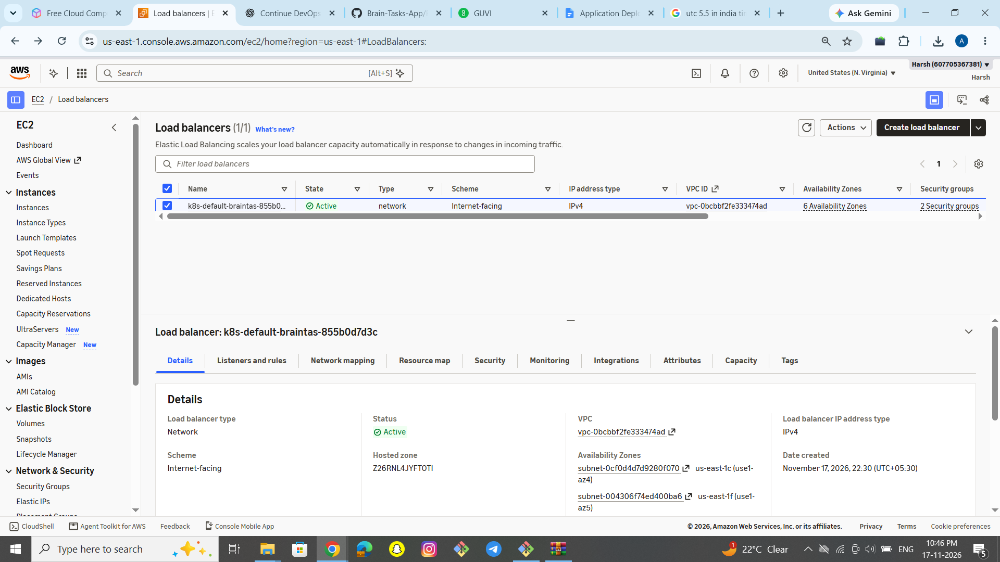
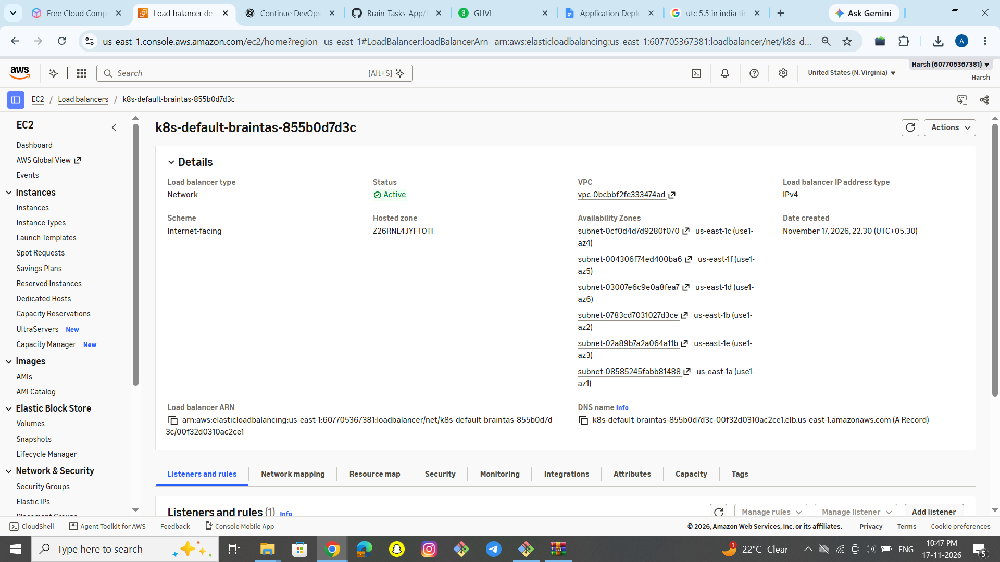
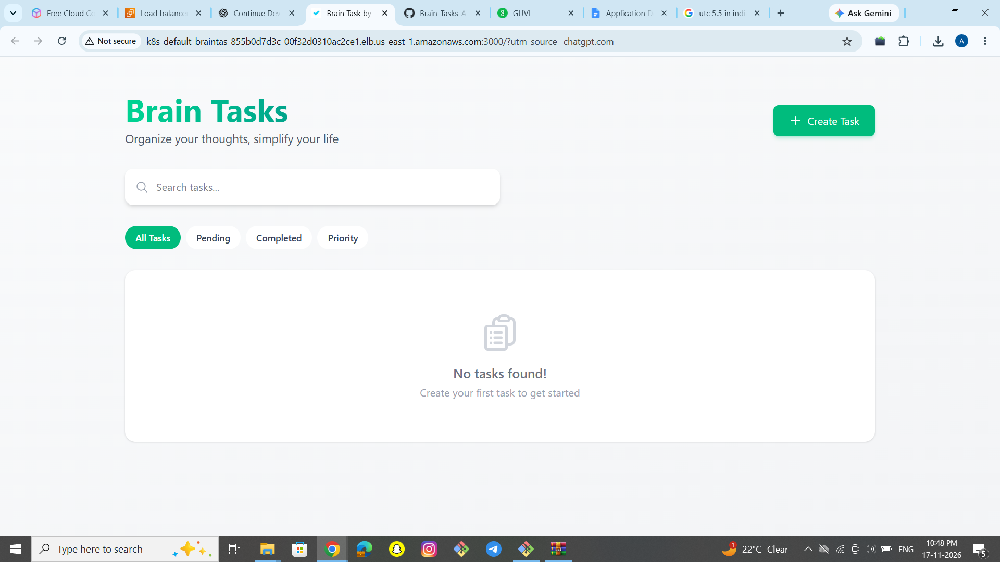

# Brain Tasks App – End-to-End AWS DevOps CI/CD Project

An end-to-end DevOps project demonstrating automated application deployment using GitHub, AWS CodePipeline, CodeBuild, Docker, Amazon ECR, Amazon EKS and Kubernetes.

## Project Architecture

GitHub → AWS CodePipeline → AWS CodeBuild → Docker → Amazon ECR → Amazon EKS → Kubernetes Service → AWS Network Load Balancer

## Technologies Used

- Git and GitHub
- Docker
- Nginx (Alpine)
- AWS CodePipeline
- AWS CodeBuild
- Amazon ECR
- Amazon EKS
- Kubernetes
- AWS IAM
- AWS EC2
- AWS Elastic Load Balancing

## Project Workflow

1. Developer pushes code to GitHub.
2. AWS CodePipeline automatically detects the change.
3. CodeBuild builds the Docker image.
4. Docker image is pushed to Amazon ECR.
5. CodeBuild connects to Amazon EKS.
6. Kubernetes Deployment updates the application image.
7. Kubernetes performs a rolling update.
8. AWS Network Load Balancer exposes the application publicly.

## Infrastructure Details

| Resource | Configuration |
|---|---|
| AWS Region | us-east-1 |
| EKS Cluster | brain-tasks-cluster |
| Node Group | brain-tasks-nodes |
| EC2 Instance | t3.small |
| Kubernetes Version | 1.37 |
| Deployment | brain-tasks-app |
| Replicas | 2 |
| Container Port | 3000 |
| ECR Repository | brain-tasks-app |
| Pipeline | Brain-test-12 |
| Load Balancer | Network Load Balancer |

## Docker Configuration

The application uses Nginx Alpine to serve the production-ready static files from the `dist/` directory on port 3000.

## Kubernetes Resources

- `deployment.yaml` – Application deployment with two replicas.
- `service.yaml` – Kubernetes LoadBalancer service.
- `brain-tasks-nlb-service` – Network Load Balancer service exposing the application publicly.

## CI/CD Pipeline

The pipeline is configured to:

- Detect GitHub source changes.
- Build a Docker image.
- Push the image to Amazon ECR.
- Update the Kubernetes Deployment in EKS.
- Verify the rollout status.

## Verification Commands

Check Kubernetes nodes:

```bash
kubectl get nodes
```

Check application pods:

```bash
kubectl get pods
```

Check deployment:

```bash
kubectl get deployment brain-tasks-app
```

Check service:

```bash
kubectl get svc
```

Check rollout:

```bash
kubectl rollout status deployment/brain-tasks-app
```

## Project Outcome

- Successfully deployed the Brain Tasks application on Amazon EKS.
- Configured two running Kubernetes replicas.
- Implemented automated CI/CD deployment from GitHub to EKS.
- Configured an AWS Network Load Balancer.
- Verified successful pipeline execution and Kubernetes rollout.
- Successfully tested public application access with HTTP 200 OK.

## Project Screenshots

### 1. AWS CodePipeline


### 2. AWS CodeBuild


### 3. Amazon ECR


### 4. Amazon EKS Cluster


### 5. Kubernetes Running Pods


### 6. Kubernetes LoadBalancer Service


### 7. Live Application


## AWS Network Load Balancer Details

The Brain Tasks App is successfully deployed on Amazon EKS and exposed to the internet using an AWS Network Load Balancer (NLB).

**Load Balancer Configuration**

- Load Balancer Type: Network Load Balancer (NLB)
- Load Balancer Name: `k8s-default-braintas-855b0d7d3c`
- Region: `us-east-1`
- Status: Active
- Scheme: Internet-facing
- Target Type: Instance
- Application Port: `3000`
- Kubernetes Service: `brain-tasks-nlb-service`

### Load Balancer ARN

```text
arn:aws:elasticloadbalancing:us-east-1:607705367381:loadbalancer/net/k8s-default-braintas-855b0d7d3c/00f32d0310ac2ce1
```

### Live Application URL

http://k8s-default-braintas-855b0d7d3c-00f32d0310ac2ce1.elb.us-east-1.amazonaws.com:3000

### Application Verification

- HTTP Response: `200 OK`
- Web Server: Nginx
- Application successfully accessible through the Network Load Balancer.

## Network Load Balancer Screenshots

### 8. AWS Network Load Balancer – Active Status


### 9. Network Load Balancer ARN


### 10. Live Application Through NLB


## 11. AWS CloudWatch Monitoring
Amazon CloudWatch is integrated with the Amazon EKS cluster to monitor build, deployment, and application logs.

### CloudWatch Configuration

- EKS Cluster: `brain-tasks-cluster`
- AWS Region: `us-east-1`
- Observability Add-on: `amazon-cloudwatch-observability`
- Add-on Version: `v7.0.1-eksbuild.1`
- Namespace: `amazon-cloudwatch`

### Monitoring Components

The following components are successfully installed and running:

- CloudWatch Agent
- Fluent Bit
- CloudWatch Observability Controller

### CloudWatch Logs

**1. Build and Deployment Logs**

CodeBuild sends Docker build, ECR push, EKS connection, and Kubernetes deployment execution logs to CloudWatch.

Log Group:

```text
/aws/codebuild/brain-tasks-codebuild
```

**2. Application Logs**

CloudWatch Observability collects Kubernetes container logs using Fluent Bit.

Application Log Group:

```text
/aws/containerinsights/brain-tasks-cluster/application
```

**3. EKS Monitoring Log Groups**

```text
/aws/containerinsights/brain-tasks-cluster/application
/aws/containerinsights/brain-tasks-cluster/dataplane
/aws/containerinsights/brain-tasks-cluster/host
/aws/containerinsights/brain-tasks-cluster/performance
```

### Verification Commands

Check CloudWatch monitoring components:

```bash
kubectl get pods -n amazon-cloudwatch
```

Check application logs:

```bash
kubectl logs deployment/brain-tasks-app
```

### CloudWatch Monitoring Screenshot


### Monitoring Outcome

- Configured Amazon CloudWatch Observability for EKS.
- Installed and verified CloudWatch Agent and Fluent Bit.
- Enabled Kubernetes container log collection.
- Created CloudWatch log groups for application and infrastructure monitoring.
- Configured CodeBuild build and deployment logging.
## Author

**Harshal Patil**

Cloud & DevOps Engineering Practice Project
